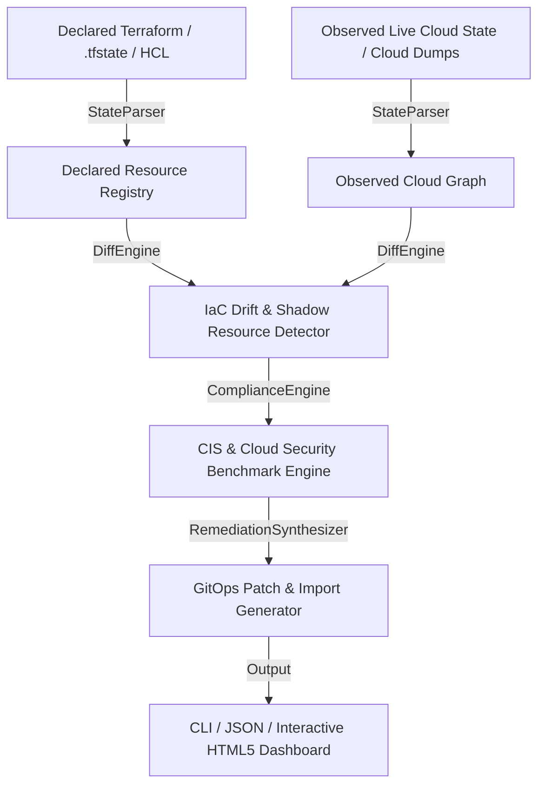

# CloudDrift Architecture

## 1. Executive Summary
CloudDrift is an Autonomous Multi-Cloud Infrastructure-as-Code (IaC) Drift & Security Compliance Remediator for Terraform/OpenTofu. It continuously reconciles declared HCL / `.tfstate` resources against observed live cloud states (AWS, Azure, GCP), pinpointing attribute drift, unmanaged/shadow cloud assets, and out-of-band security degradations (e.g. open security groups, unencrypted storage, wildcard IAM privileges), while synthesizing automated GitOps pull request diffs and `terraform import` scripts.

## 2. Architecture Diagram

## 3. Core Engine Components
- **`core/models.py`**: Rich domain models for Cloud Resources, Resource Attributes, Drift Findings, Compliance Violations, and Remediation Plans.
- **`core/state_parser.py`**: Stream parser for Terraform State v4 (`terraform.tfstate`), plan JSONs, and multi-cloud live resource dumps.
- **`engines/drift_detector.py`**: Recursive deep structural diff engine identifying attribute drift, missing declared resources, and unmanaged/shadow cloud infrastructure.
- **`engines/compliance.py`**: CIS Benchmark and cloud hardening rules engine evaluating encryption, network perimeter exposure, IAM least privilege, and public access blocks.
- **`engines/remediation.py`**: Synthesizes automated GitOps HCL remediation patches, CLI cloud reversal commands, and `terraform import` scripts.
- **`reporters/`**: Formatted CLI summaries, machine-readable JSON for DevSecOps, and standalone interactive HTML5 dashboard.
