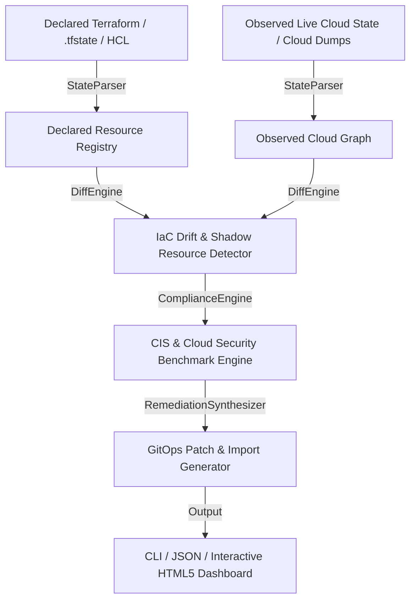

# CloudDrift ☁️

> **Status:** prototype. A personal security-research project, not a production product. Expect rough edges; issues and pull requests are welcome.

> **Autonomous Multi-Cloud IaC Drift & Security Compliance Remediator for Terraform/OpenTofu**

CloudDrift is a prototype Infrastructure-as-Code (IaC) drift detection and security remediation platform. It continuously reconciles declared Terraform / OpenTofu state definitions against observed live multi-cloud environments (AWS, Azure, GCP), identifying unmanaged shadow infrastructure, configuration attribute drift, and out-of-band security degradations (e.g. open ingress rules, unencrypted storage, missing public access blocks, and wildcard IAM permissions).

---

## 🌟 Key Capabilities

- **State & Cloud Ingestion**: Stream-parses Terraform State v4 (`terraform.tfstate`), plan JSONs, and multi-cloud live inventory snapshots.
- **Shadow IT & Unmanaged Discovery**: Pinpoints unmanaged resources created out-of-band via ClickOps in the cloud console that are missing from Terraform code.
- **CIS Benchmark Compliance Engine**: Validates cloud resources against CIS AWS Foundations Benchmark:
  - 💥 Security Groups allowing open ingress `0.0.0.0/0` on sensitive ports (SSH 22, RDP 3389, Database 5432/3306).
  - 💥 S3 Buckets missing Public Access Block or with public read ACLs.
  - 🚨 S3 Buckets lacking default AES256 server-side encryption at rest.
  - 🚨 Unencrypted EBS storage volumes.
  - 💥 IAM Policies or Roles granting wildcard `*` permissions.
  - 💥 Database instances configured with public internet accessibility.
- **Automated GitOps Remediation**:
  - Synthesizes hardened Terraform HCL blocks updating code to enforce compliance.
  - Generates automated `terraform import` shell scripts for all unmanaged shadow assets.
  - Produces cloud provider reversal CLI commands for rapid containment.
- **Interactive Visual Dashboard & CI Gate**: Renders formatted CLI tables, machine-readable JSON for DevSecOps, and standalone interactive HTML5 executive dashboards with build-breaking threshold gates (`--fail-on-severity HIGH`).

---

## 📐 Architecture



---

## 🚀 Quick Start

### 1. Installation

```bash
git clone https://github.com/csenta/cloud-drift.git
cd cloud-drift
pip install -r requirements.txt
```

### 2. Compare Declared State against Live Cloud

```bash
python3 -m cloud_drift.cli diff \
  --declared examples/declared_state.json \
  --live examples/live_cloud_state.json \
  --output-json report.json \
  --output-html report.html
```

### 3. Generate Automated Terraform Import Script

```bash
python3 -m cloud_drift.cli import \
  --declared examples/declared_state.json \
  --live examples/live_cloud_state.json \
  --output import_unmanaged.sh
```

### 4. Synthesize GitOps HCL Hardening Patches

```bash
python3 -m cloud_drift.cli remediate \
  --declared examples/declared_state.json \
  --live examples/live_cloud_state.json \
  --output-hcl remediation.tf
```

### 5. Enforce CI/CD Quality Gate

```bash
python3 -m cloud_drift.cli diff \
  --declared examples/declared_state.json \
  --live examples/live_cloud_state.json \
  --fail-on-severity HIGH
```

---

## 🛠️ Testing

Run the test suite:

```bash
PYTHONPATH=. python3 -m unittest discover -s tests -v
```

---

## 🐳 Docker Deployment

Run with Docker Compose:

```bash
docker-compose up --build
```

## License

MIT. See [LICENSE](LICENSE).
